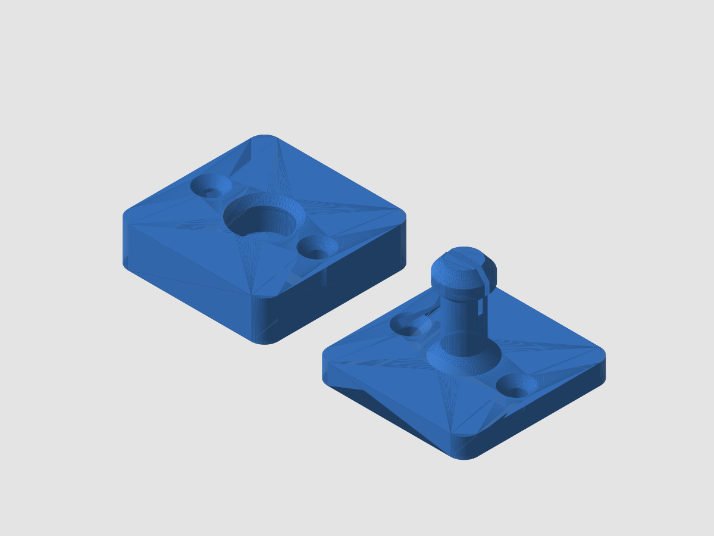

# RV entry door holder catch (plunger and socket)

A two-piece catch that holds an RV entry door open. The plunger plate screws to the door and its
stem ends in a bulb; the socket plate screws to the wall or frame and has a tapered cavity that the
bulb snaps into with a light click. Pull the door to release it. Each plate is about 45 x 45 mm with
two screw holes 32 mm apart, so it can stand in for many common surface-mount holders. It is a
simple replacement for a broken or lost catch, not a precise copy of any one brand.

## Files
- `rv-door-holder-socket.stl` - socket plate (45 x 45 x 12 mm)
- `rv-door-holder-plunger.stl` - plunger plate with stem (45 x 45 x 31 mm)
- `rv-door-holder-plate-of-both.stl` - both parts side by side on one build plate (105 x 45 x 31 mm)
- `generate.py` - parametric source (build123d); run `python generate.py` to re-export

## Parameters (in `generate.py`)
| Parameter | Default | Meaning |
|---|---|---|
| `stem_d` | 10 mm | Plunger stem diameter (bulb is `stem_d` + 4 mm) |
| stem length | 25 mm | `length` in `build_plunger` |
| `interference` | 0.4 mm | How much wider the bulb is than the socket neck (snap force) |
| hole spacing | 32 mm | `hole_dx` = 16 mm each side of centre; 4.5 mm holes, countersunk 9 mm |

The bulb has a thin slit so it can squeeze through the neck. For a stiffer hold raise `interference`
by 0.1 mm at a time; for a lighter hold lower it.

## Recommended print settings
- Material: PETG for interior use; ASA if the part sees sun or heat.
- 0.2 mm layers, 4 walls, 40% infill, no supports.
- Orientation (as exported): plates flat on the bed, stem pointing up, socket opening up. Every overhang
  is 45 degrees or shallower, so no supports. Layers run parallel to the plates, which keeps the
  screw-clamped plates strong. The stem is the weak direction (pulls across layers): the stem has a thick
  root cone, and 4 walls helps. If it still snaps, print the plunger at 100% infill.

## Notes
This is a free design offered as-is, with no guarantee of fit. Check hole spacing and clearance on your door before printing.

Don't have a printer? PartRevive prints this and ships it: https://jdinneen.github.io/partrevive/parts/rv-door-holder-catch/
