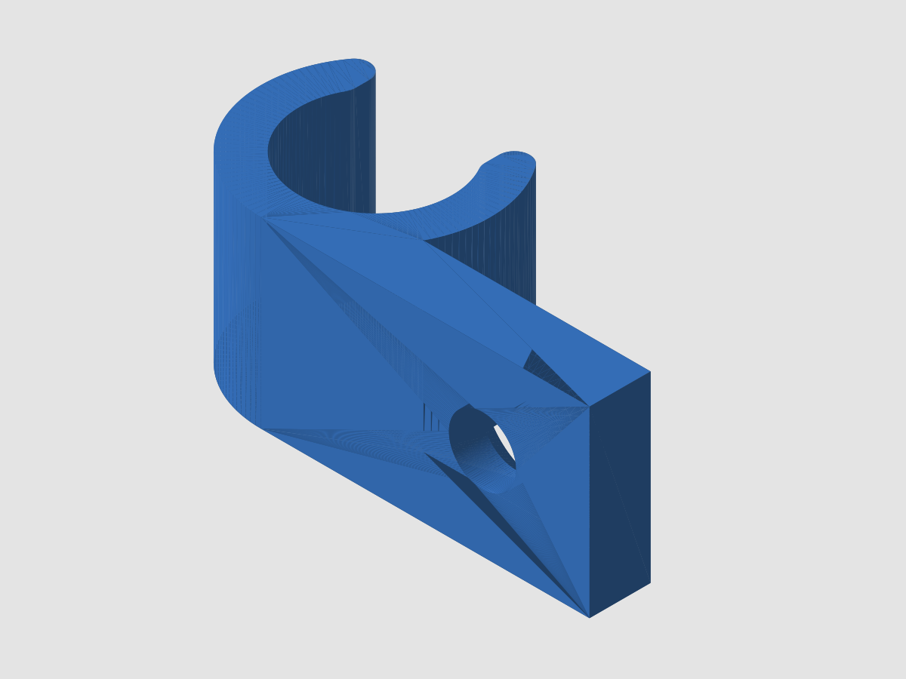

# Sun-visor rod retainer clip

A small C-shaped snap clip that grips the round metal rod a car sun visor pivots on, so a visor
that has lost its clip stops flopping and stays on its rod. The flat tab on the side takes one
countersunk screw into the headliner bracket or any flat surface. It fits round rods of 8-14 mm
diameter; STL variants are included for 9, 10, 11 and 12 mm rods. Measure your rod with calipers
and pick the closest size (or regenerate with your exact diameter).

## Files
- `sun-visor-clip_rod9.stl`, `_rod10.stl`, `_rod11.stl`, `_rod12.stl` - ready to print
- `generate.py` - parametric source (build123d); run `python generate.py` to re-export

## Parameters (top of `build_clip` in `generate.py`)
| Parameter | Default | Meaning |
|---|---|---|
| `rod_d` | 10 mm (range 8-14) | Rod diameter the clip grips |
| `screw_d` | 4 mm | Screw shank diameter (hole gets +0.4 mm clearance) |
| `wall` | 2.5 mm | Wall thickness |
| `depth` | 12 mm | Clip depth along the rod |
| `snap` | 0.85 | Opening width as a fraction of `rod_d` (15% narrower than the rod) |
| `tab_len`, `tab_t`, `head_d` | 14, 4, 8 mm | Mounting tab length and thickness, countersink head diameter |

Snap lips are rounded with a 1 mm fillet.

## Recommended print settings
- Material: PETG for interior use; ASA for anything in direct sun (a parked car gets hot enough to soften PETG).
- 0.2 mm layers, 4 walls, 40% infill, no supports.
- Orientation (as exported): the ring axis points straight up. Every layer is then the full C shape,
  so the lips flex along the layers instead of splitting between them. The screw hole is horizontal and small enough to bridge cleanly.
- If the clip is too tight or too loose on your rod, change `rod_d` by 0.2-0.3 mm and re-export.

## Notes
This is a free design offered as-is, with no guarantee of fit on your vehicle. Check the rod diameter and mounting spot before printing.

Don't have a printer? PartRevive prints this and ships it: https://jdinneen.github.io/partrevive/parts/sun-visor-clip/
