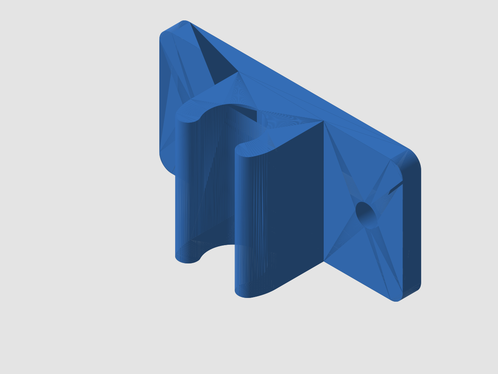

# Tonneau cover prop-rod retention clip

A small screw-down clip with an open U-shaped jaw that holds a round prop rod (the rod that props
a tonneau or truck-bed cover open) when it is stowed, so it stops rattling. Screw the flat base to
the cover or rail with two small screws, then push the rod into the jaw. Variants are included for
6, 8 and 10 mm rods; measure your rod with calipers and choose the closest.

## Files
- `tonneau-prop-rod-clip_rod6.stl`, `_rod8.stl`, `_rod10.stl` - ready to print
- `generate.py` - parametric source (build123d); run `python generate.py` to re-export

## Parameters (in `generate.py`)
| Parameter | Default | Meaning |
|---|---|---|
| `rod_d` | 8 mm | Rod diameter (variants 6, 8, 10) |
| jaw opening | 85% of `rod_d` | `open_frac`; rod snaps past it |
| jaw height | `rod_d` + 6 mm | Measured above the base, before the lip rounding |
| `wall` | 3 mm | Jaw wall |
| base | 40 x 20 x 3 mm | Two 3.5 mm holes, 28 mm apart |
| `outer_fillet` | 1.5 mm | Outer lip rounding (inner lip 1 mm) |

## Recommended print settings
- Material: PETG for interior use; ASA for outdoor or sun exposure.
- 0.2 mm layers, 4 walls, 40% infill, no supports.
- Orientation (as exported): the jaw axis points straight up, so the base stands on its edge. Every layer is the
  full U-profile and the lips flex along the layers instead of delaminating. There are no overhangs, so no supports.

## Notes
This is a free design offered as-is, with no guarantee of fit. Check the rod diameter and mounting spot before printing.

Don't have a printer? PartRevive prints this and ships it: https://jdinneen.github.io/partrevive/parts/tonneau-prop-rod-clip/
